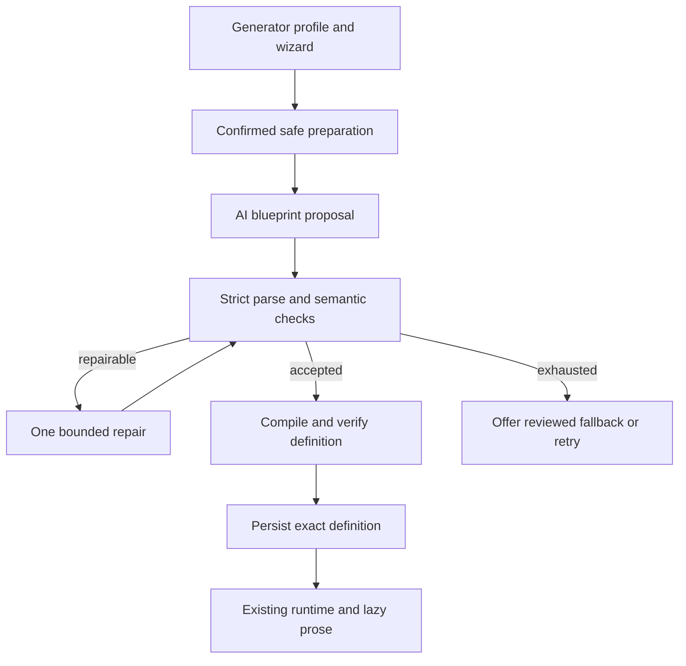

# Spec 27.17 — Dynamic Game Generation Architecture and Preparation Wizard

**Type:** Architecture decision and implementation-planning specification  
**Parent:** Universal engine series, following Spec 27.16  
**Depends on:** Existing Specs 22–27.16; preserve their authored/content-generation paths  
**Baseline:** Inspected local checkout of `main`, commit `bbc66e8fd55e9c3ca1390705614bf0bba4d4b07c`, on 2026-10-23. Existing unrelated modification to `SceneOption.java` was not changed. No build or live-provider test was run for this specification. Implementers must inspect their current checkout again.  
**Status:** Accepted architecture; documentation integration complete, downstream implementation begins with Spec 27.18  
**Primary outcome:** Establish a scenario-neutral architecture in which a player uses a short preparation wizard, optionally describes the game they want in free text, reviews their settings, and requests a newly generated game. AI proposes a complete bounded game blueprint; deterministic code validates and compiles it before the existing runtime executes any gameplay.  
**Repository location:** `docs/specifications/27.17-engine-dynamic-game-generation-architecture-instruction.md`

---

## 1. Intent and product outcome

### 1.1 Problem

Current generated games are tied to an authored pack. Willow Marsh fixes the scene graph, choices, state, objectives and endings; AI primarily changes their presentation. Changing a theme or submitting a story wish therefore cannot reliably produce an unrelated adventure with different routes and objectives.

### 1.2 Desired experience

A player chooses **New AI game**, answers a few friendly questions, and may enter a short fictional idea such as:

> A team of animal explorers repairs a stranded spacecraft on a floating island. Include a mystery and a helpful robot.

The resulting game should reflect that idea through a new premise, cast, objectives, scene graph and bounded consequences, rather than forcing it into a marsh, a missing lens and a festival. The player does not author JSON, know internal IDs, select effect classes, or manually build a fixture.

### 1.3 Constraints

- The engine remains independent of Spring, React, databases, CapyBee branding and provider SDKs.
- Safety, privacy, supported mechanics, budgets and deterministic execution remain engine-controlled.
- User wishes are creative input, not executable instructions or authorization to override policy.
- Authored games and the existing pack-based generated-presentation mode remain available.
- Console-first delivery; this document defines a host-neutral wizard contract, not a web screen implementation.
- No automatic reading of account history, child profiles, mood, location, missions or other app data.

### 1.4 Intent traceability

This changes the earlier “AI fills authored slots only” decision in `intent/01-universal-game-engine.md`. On integrating this spec, add a short intent note in `docs/specifications/intent/` using the next unused number, recording this user request and pointing to 27.17–27.27. Preserve the older intent as history; do not silently rewrite it to claim dynamic mechanics were always supported. The four intent answers are provided by §§1.1–1.3 and the affected users are players, host developers and engine maintainers.

## 2. Verified baseline and gaps

| Existing component | Observed behavior | Architectural consequence |
| --- | --- | --- |
| `GenerationCatalog` | Declares fixed stages, actor/objective slots, scene IDs and choice IDs. Its stages are THEME, SCENARIO, CAST, QUEST and SCENE. | Add a separate blueprint bootstrap contract; do not imply GAME_BLUEPRINT already exists. |
| `GenerationPipeline` constructor | Requires a playable `Pack`, trusted scenes and parsed rules before generation. | A scenario-neutral generator profile cannot simply be passed into this constructor. |
| `GenerationPipeline.compose()` | Replaces narration and labels but retains trusted routes, effects, requirements, branches and outcomes. | Keep this presentation boundary after the new definition has been compiled. |
| `GenerationArtifact` | Stores narrative payloads, provenance and quality stamps, not a complete generated mechanical definition. | A new versioned definition contract and persistence boundary are required. |
| `FullGeneratedGameValidator` | Validates a pack's authored graph and five ordered phases. | Extract reusable checks; structural reachability alone does not prove conditional playability. |
| `GenerationSetup` / `StartInputDef` | Support preset questions and optional free text, with localized option metadata. | Extend existing concepts instead of inventing a second input type system. |
| `InteractiveSetup` | Already presents questions, back/cancel, disclosure, a review and confirmation. It is pack-driven. | Reuse/refactor it for profile-driven setup; do not add a parallel CLI wizard. |
| `StartInputProcessor` / `PreparedStartInputs` | Normalize, bound, scrub and guard free text; distinguish persistent presets from transient safe text. | Retain one safety path and adapt its input-definition source to profiles. |
| `RunState` / `SnapshotCodec` | Persist generated artifacts; restore still depends on the pack definition. | Persist the new materialized game definition, not just the prose. |

The current CLI presenter contains hardcoded English host copy and reparses setup JSON. This is a gap to resolve in the later CLI spec, not evidence that friendly profile-driven EN/PL setup is already complete.

## 3. Scope of 27.17

This specification owns architectural decisions, terminology, wizard behavior, trust boundaries, lifecycle, ownership of subsequent work and series acceptance criteria.

Implementation of 27.17 itself is limited to reviewing/documenting these decisions, adding intent/index references when integrated, and reconciling incompatible assumptions in the roadmap. It does **not** require stub production classes, placeholder endpoints, an inactive new CLI flag, or implementing all subsequent specifications in one change.

Subsequent specs refine exact Java signatures, JSON fields, versions, error codes and persistence formats while honoring this architecture. Names below describe intended responsibilities, not existing APIs.

### Non-goals

- New mechanics implemented by generated Java, scripts, SQL or arbitrary expressions.
- A model deciding state mutations or routing directly at every player turn.
- A second gameplay runtime alongside `RunImpl`.
- Unlimited open-world play or unbounded cyclic graphs in the first version.
- Generating images/assets, downloading resources or following URLs from a story wish.
- Multiplayer, shared personalized game caches, profile memory or transcript collection.
- Implementing the React wizard or HTTP transport in this spec series.
- Changing existing fixture semantics to make every test generate a different game.

## 4. Architectural decisions

| ID | Binding decision |
| --- | --- |
| D1 | A **fixture** remains stable test data. A new game produces a **blueprint**, not a new fixture. |
| D2 | A **GeneratorProfile** is authored, versioned, scenario-neutral configuration: capabilities, limits, setup metadata, audience policy, fallback selection and generation budgets. |
| D3 | A **GamePreparation** is the validated preset selection plus a separate transient approved suggestion. No raw/scrubbed free text is embedded in a serializable request DTO. |
| D4 | A **GeneratedGameBlueprint** is an untrusted model proposal for premise, cast, objectives, declared state, graph, choices and endings. Successful JSON parsing does not make it trusted. |
| D5 | A **MaterializedGameDefinition** is the immutable result of validation, engine ID assignment, compilation and final verification. Only this definition is executable. |
| D6 | The whole mechanical blueprint is accepted before the first gameplay command. Later AI calls fill presentation only. |
| D7 | Dynamic generation is explicit. Existing authored and fixed-pack generated modes keep their semantics and restore paths. |
| D8 | Wizard selections constrain the new definition; they do not directly mutate engine state or introduce new condition/effect types. |
| D9 | Generator configuration supplies no Willow Marsh actor roles, scene IDs, goals or plot as hidden defaults. A reviewed fallback is separate and explicitly identified. |
| D10 | Profile policy and safety are hard limits. Free text cannot override them, regardless of wording or prompt injection. |
| D11 | A new request attempts a new blueprint; variation is expected but absolute uniqueness cannot be guaranteed. A saved run never regenerates its blueprint on resume. |
| D12 | External generation is optional. Without a provider, offer a clearly labeled reviewed offline game or cancel; do not claim a fresh AI game was generated. |
| D13 | Persist the exact accepted definition and generated content, not the original suggestion. A seed alone cannot reproduce live provider responses. |
| D14 | Blueprint repairs and later prose generation reuse existing provider, safety, budget and quality infrastructure where applicable, without pretending current artifact contracts already support mechanics. |

## 5. Game preparation wizard

### 5.1 Entry and resume

For a selected dynamic generator profile, starting a new interactive game opens the wizard by default. The player must not need a special list of internal `--input` keys.

If an unfinished game exists, offer **Resume game**, **Prepare a new game**, or **Cancel** first. Resume bypasses the wizard and restores the saved definition. Preparing another game must not abandon/overwrite the saved run before explicit confirmation and the existing session lifecycle rules permit it.

The profile and capabilities are loaded and validated before showing unsupported choices. Invalid configuration fails locally before any provider request.

### 5.2 Short, guided flow

Support a quick-start path with visible defaults and a customization path. Target at most six customization questions, followed by one review. Do not require every optional question to be answered.

| Step | Suggested player-facing choice | Contract |
| --- | --- | --- |
| 1. Kind of adventure | Mystery, exploration, helping/repair, puzzle adventure, or surprise me | Profile-backed preset; surprise means no additional genre constraint, not a forced marsh plot. |
| 2. World | Nature, fantasy, space, everyday fictional world, or surprise me | Optional creative preference; options come from profile metadata. |
| 3. Feel and focus | Cozy/curious/adventurous; optionally up to two interests | Tone is bounded by audience policy. If combined in one CLI step, fields still validate independently. |
| 4. Length and challenge | Short/medium; gentle/standard | Length maps to exact graph bounds; challenge selects a supported mechanic preset. No promised play-time duration without evidence. |
| 5. Language | Supported profile locales only | Explicit locale is a hard constraint. Host interface and game locale can be represented separately. |
| 6. Your own idea | Optional short fictional suggestion | Skip is always available; no default free text. |
| Review | Friendly preset labels, suggestion status, provider mode | Edit/back, start or cancel; no network generation before confirmation. |

Profile authors may omit unsupported questions. Do not display a control that has no defined downstream effect. Audience policy is host/profile-controlled, not a child-editable “remove safety” setting. Do not request birth date, school, real name or precise location.

“Use defaults” must preserve an explicitly selected locale and explain the selected length/challenge. “Surprise me” grants creative latitude within the same policy and capability limits.

### 5.3 Free-text suggestion

- Friendly label: “What would you like your game to be about?”
- Explain that it is optional, may influence the generated game, and cannot guarantee unsupported gameplay features.
- Retain the current full-game bound: default maximum 300 Unicode code points; profiles may lower it, not silently raise it. Validate after normalization using the shared processor.
- Do not silently truncate overlong text. Offer edit, skip or cancel.
- Accept Unicode and multiline text in hosts that support it; CLI v1 may use a single bounded line without requiring a multiline editor.
- Do not echo suggestion text in review, errors or application output. Display `[provided]`, `[skipped]`, or `[needs editing]` only. A GUI may locally show/edit its own input control, but must not duplicate the text into diagnostic output.
- CLI terminal-local typing visibility is not a promise of secret entry. Avoid application echo; never put text in argv, environment variables, URL parameters or normal script files.
- Provide fictional examples without real-world identities. Do not imply scrubbing guarantees removal of all private information.
- A request such as “space explorers” should shape premise, actors, goals and graph planning, not only the title or scene wording.
- Wishes for unsupported genres/mechanics are adapted within the profile or rejected with an actionable generic explanation; never falsely claim an unsupported feature was implemented.

### 5.4 Disclosure and confirmation

Before collecting optional text, show a short provider disclosure: setup selections and the approved suggestion may be sent to an external AI service; do not enter private information; the original suggestion is not saved; accepted story content reflecting the idea is saved with the game.

Final **Start game** is the external-processing confirmation. Before it, local review/edit/back/cancel causes zero external calls, including calls to an external-capable safety guard. After it, the shared safety flow may run the guard and generation. A guard unavailable at that point fails closed for the text, not for all preset-only play.

Explain during preparation that cancellation can stop further calls but cannot retract already submitted requests or guarantee zero provider charges.

In provider-free mode, explain the limitation before collection, omit the unused suggestion field, and identify the reviewed fallback. Show only preferences the fallback can actually honor; reject unsupported locale or length rather than silently substituting them.

### 5.5 Editing, defaults and conflicts

- Back/edit preserves previous preset selections. Enter keeps the displayed existing/default preset rather than unexpectedly resetting it.
- Optional fields have a distinct skip/clear action; omission and an explicit selection must not be conflated.
- Raw suggestion remains in ephemeral wizard memory only until edit, skip, cancel or completion. On revisiting it, show its status; allow keep, replace or clear without printing it.
- Hard constraints take precedence: policy/capabilities, locale, length bounds and selected challenge preset.
- Genre, setting, tone and interests are creative preferences. The suggestion adds detail but does not silently replace a conflicting explicit preference. Offer editing at review; if conflict is only detected during generation/validation, request correction or adaptation within the explicit settings.
- Do not use another provider call merely to summarize or classify the setup before confirmation. The blueprint stage interprets the approved idea.
- New setup after a previously sent request requires a fresh confirmation before another generation attempt.

## 6. Privacy and trust boundaries

### 6.1 Data separation

| Data | Lifetime and allowed use |
| --- | --- |
| Profile ID/version and bounded preset IDs | May persist for run provenance and recovery. No automatic cross-run preference memory. |
| Raw/normalized/scrubbed/approved suggestion | Ephemeral only; never in snapshots, pending-start storage, traces, logs, request IDs, hashes of the suggestion, crash reports or CLI transcripts. |
| `PreparedStartInputs`-style safe text capability | Non-serializable by design; consumed by the blueprint-start operation, then references released. No claim of guaranteed JVM memory erasure. |
| Validated blueprint and compiled definition | Persist per game; may reflect the safe fictional idea but must not include a copied `originalSuggestion`, prompt dump or input-history field. Apply output safety/PII checks before accepting. |
| Generated scene prose | Persist through existing accepted-artifact semantics; personal suggestions must not enter a shared cross-player cache. |
| Diagnostics | Bounded stage/status/error codes, numeric usage and internal IDs only; no prompt, response, player text or derived content excerpts. |

### 6.2 Processing order

1. Load and validate profile; collect/review inputs locally.
2. Obtain confirmation before any external-capable processing.
3. Normalize and bound text, scrub detected PII locally, then inspect scrubbed text through the existing safety port.
4. For block, clarification or unavailable safety: offer replace, skip and continue with presets, or cancel. Never silently submit the original text or silently discard it while claiming it was used.
5. Route approved text to GAME_BLUEPRINT only. A bounded repair attempt for that same blueprint stage may reuse it while the start operation is alive; do not put it in repair diagnostics or persisted repair records.
6. Subsequent CAST/QUEST/SCENE stages receive accepted blueprint data, never the original suggestion directly.
7. Check generated output for safety and private data before materialization/persistence.

This intentionally extends Spec 27.8's routing whitelist for the **new dynamic mode only**: GAME_BLUEPRINT receives transient text. Existing fixed-pack THEME/SCENARIO routing remains unchanged. This also intentionally supersedes the older ban on setup influencing mechanical structure, but only through validated blueprint compilation. Nothing may mutate trusted runtime state directly.

## 7. End-to-end architecture

Compilation failures are not accepted definitions. Classify malformed/invalid proposals for the same bounded repair allowance; internal compiler defects fail safely with no playable run published. Never restart an unbounded repair loop because the failure occurred in a different layer.

### 7.1 Responsibilities

- **Host wizard:** rendering, accessible/localized controls, in-memory draft, review, confirmation and cancellation. No duplicate safety rules.
- **Generator profile loader:** authored capability and setup metadata validation; no network calls.
- **Preparation processor:** shared normalization, preset validation, safety handling and transient text ownership; no serialized free-text request.
- **Blueprint generator:** provider-neutral structured request, budget reservations, provenance and bounded repair.
- **Blueprint validator:** schema/reference checks, policy/capability checks, graph bounds, objective/condition consistency and constraint satisfaction.
- **Compiler:** deterministic mapping of symbolic references into engine-owned IDs and supported runtime structures. Model IDs are not accepted as engine IDs.
- **Definition validator:** validates compiled scenes/rules and reuses applicable pack-level checks. A raw syntactically valid JSON graph is not trusted.
- **Runtime:** authoritative condition evaluation, effects, objective completion, movement, outcomes and snapshots.
- **Presentation generation:** scene prose, dialogue and labels constrained by the materialized choices and their actual semantics.
- **Session/persistence layer:** atomic publication of the definition and initial accepted artifacts; immutable definition identity throughout the run.

### 7.2 First-version mechanical limits

Keep existing supported DSL types as the only vocabulary. Initial profiles use conservative finite bounds on scene counts, counters, flags, sets, objectives and branch count. Five ordered story phases may remain as a generic structural convention; no particular setting, role or objective belongs in the convention.

Do not rely on graph connectivity to prove a gated ending is achievable. Later validation must analyze reachable bounded states, with an explicit exploration limit. If it cannot establish required playability within that limit, reject the blueprint or restrict the profile; do not report it as proven playable. Objective achievement may vary by route, but every advertised ending/objective needs an allowed achievable witness and no reachable nonterminal state may strand the player without a permitted completion route. Exact guarantees and limits belong to 27.21/27.22.

If PLACES is not supported by the initial dynamic profile, do not inherit Willow Marsh places or silently allow GO_TO. A future enabled places capability must compile and validate its own place graph and scene bindings.

### 7.3 Durable startup and recovery

Before confirmation, no run is created. After confirmation, PREPARING may persist content-free status, safe presets and idempotency metadata, but never the suggestion. A crash before an accepted definition cannot recreate the original text: offer re-entry, preset-only retry or cancel, without claiming the wish was retained.

Publish a playable run only when its validated definition and initial accepted content are durably committed. Retry/replay must not publish duplicate games or repeat state effects. Provider calls can have occurred before a crash; reserve/account for them conservatively using the session ledger.

On resume, load the exact persisted materialized definition and already accepted artifacts, verify compatibility/integrity and do not regenerate the blueprint. A missing newer local profile must not automatically replace the saved graph. Persistence spec 27.26 defines retained dependencies and explicit incompatibility handling. Resume may request previously unresolved prose later, but restoring already accepted content makes no regeneration calls.

### 7.4 Fallback semantics

Blueprint failure offers retry/edit, cancel or one complete validated reviewed fallback. Label its provenance honestly and do not claim it satisfies a custom wish it does not satisfy. Do not mix its objectives/graph with a rejected generated blueprint.

After a blueprint has been accepted, scene fallback must be built deterministically from that definition's actual actors, choices, requirements and objective/state facts. It must not import festival/lens/marsh narrative or fabricate success. A failure at this point cannot silently switch the entire game to another graph.

## 8. Compatibility rules

- Keep current authored Pack loading, schema-v1/v2 catalog behavior and historical snapshot restoration available.
- Do not redefine FULL_GAME to imply a dynamic blueprint already exists. Expose explicit definition-origin/capability metadata; exact schema is owned downstream.
- Preserve Willow Marsh and minimal fixtures as regression/reference assets.
- Do not treat GeneratorProfile as a playable Pack with missing scenes. Add a bootstrap layer that materializes a playable definition before ordinary runtime construction.
- Reuse TextGenerator, StructuredGenerationRequest, InputGuard and injected ID/time/randomness ports. No vendor SDK in core.
- Do not invent a new mechanics interpreter. Compile to supported rule/scene structures and use the existing engine.
- Profile setup evolution must not weaken existing privacy protections for non-dynamic packs.
- Keep wizard questions host-neutral; future web adapters implement the same behavior without moving CLI IO into core.

## 9. Specification ownership and delivery order

| Spec | Owns | Must not duplicate |
| --- | --- | --- |
| 27.17 | This architecture, wizard behavior, trust boundary and series plan | Production implementation of the complete series |
| 27.18 | GeneratorProfile schema, capabilities, setup metadata, defaults, localizations and hard/soft constraint mapping | Game-specific graph definitions |
| 27.19 | Blueprint schema, strict parser, symbolic-reference contracts, versioning; reserved mechanics shapes | Provider orchestration or rule execution |
| 27.20 | GAME_BLUEPRINT requests, prepared-input routing, bounded repair and whole-blueprint fallback coordination | A second safety processor or standalone validator |
| 27.21 | Semantic validator, bounded playability analysis contract and reusable graph checks | New effect implementations |
| 27.22 | Allowed mechanics subset, state/condition/effect rules, detailed achievability integration | Arbitrary expressions or a parallel DSL interpreter |
| 27.23 | Deterministic compiler, trusted IDs and immutable materialized definition | Executing the game during compilation |
| 27.24 | Bootstrap/session/runtime integration and definition publication | A second Run implementation |
| 27.25 | Blueprint-driven cast/quest/prose presentation, continuity, prefetch and scene fallback | Changing the accepted mechanical graph |
| 27.26 | Definition/artifact codecs, atomic persistence, migration and process recovery | Saving original setup text |
| 27.27 | Existing CLI wizard adaptation, setup/review/retry UX, scripts, end-to-end tests and release evidence | React screens or bypassing core validation |

Keep these numbers stable. The earlier suggested 27.12 dynamic-blueprint filename is obsolete: 27.12–27.16 already name other repository specs.

This sequence is a drafting/review order, not permission to ship half-integrated dynamic play. Spec 27.20 may use a validator port/fake until 27.21; 27.19 and 27.21 define contracts refined by the 27.22 mechanics subset. Do not add unsupported effect placeholders to production to satisfy the order. Review 27.19–27.22 together before integrating the provider path.

27.24/27.25 may be tested in memory, but durable dynamic gameplay remains unreleased until 27.26 is complete. The public wizard-driven command is released only after 27.27 verifies the integrated path. Each implementation still includes focused tests rather than postponing all testing to 27.27.

## 10. Acceptance criteria

### 10.1 Completion criteria for 27.17 itself

1. Architecture and terminology distinguish profile, preparation, untrusted blueprint, trusted compiled definition and prose artifact.
2. The wizard, custom suggestion, confirmation, edit/cancel, conflicts and offline modes have explicit contracts.
3. Privacy invariants and intentional changes to 27.8/26.1 are documented, not silently contradicted.
4. Responsibilities and downstream ownership are accepted; exact schemas are deferred to their named specs.
5. Intent/index references are added on repository integration without changing unrelated source code or claiming runtime behavior has shipped.

### 10.2 Required evidence before releasing the complete series

| Case | Required proof |
| --- | --- |
| Quick start | Valid profile defaults can create a game without a custom suggestion. |
| Custom wizard | Selected locale/length/challenge survive into validated blueprint constraints and actual compiled behavior. |
| Custom idea | Deterministic provider tests inspect safe GAME_BLUEPRINT context; a space-rescue response compiles and plays without Willow Marsh IDs/roles/objectives. Live semantic fidelity is separately reviewed, not claimed proven by keyword matching. |
| Structural variation | Distinct controlled provider responses produce different graph topology/objectives, not just different names. No requirement that arbitrary two live responses be unique. |
| Conflict | A short PL game request cannot silently become a long EN game because the free text requested it. |
| Skip/back/edit | Existing choices are retained, optional text can be cleared, no text is printed, and final values—not abandoned drafts—reach preparation. |
| Pre-confirmation cancel | Zero provider/remote-guard calls; zero new run; existing saved run unchanged. |
| Unsafe/PII input | Shared scrub/guard path enforced; block/unavailable offers edit/skip/cancel without leaking text into diagnostics or saves. |
| Prompt injection | Suggestion cannot raise limits, alter policy, add effect types, execute code or follow URLs. |
| Invalid blueprint | Unknown fields/references, impossible gating, excessive states/cycles/length or unsupported mechanics are rejected before runtime. |
| Bounded repair | One total blueprint repair maximum; budget exhaustion offers explicit retry/cancel/reviewed fallback, never an unbounded loop. |
| Offline | No call and no useless suggestion prompt; reviewed fallback is labeled and incompatible hard settings are not silently ignored. |
| Scene failure | Definition-specific fallback preserves actual choices/effects and does not import another game's narrative. |
| Resume | Second-process restart restores identical definition/IDs/content with no blueprint or accepted-prose regeneration; future unresolved prose may still generate. |
| Pending-start crash | Original suggestion absent on disk; recovery asks for re-entry or uses presets only with honest disclosure. |
| Compatibility | Existing authored and generated-pack tests remain green; historical snapshots keep their documented restore behavior. |
| Host independence | Core has no terminal/UI/network SDK dependency; EN/PL host-copy tests and UTF-8 CLI tests are separate from locale-neutral engine tests. |

## 11. Implementation handoff

Before implementing, inspect current Git status, relevant engine guidance, current APIs and the related specs. Preserve unrelated changes, especially any pre-existing SceneOption work. Report discrepancies against this baseline before changing overlapping contracts.

For 27.17: make documentation/decision changes only. Do not start implementing 27.18–27.27 implicitly. Record the accepted architecture and any unresolved contract questions, then prepare 27.18 using this document as its authority.

For the completed series: run the engine's actual documented Maven verification gate, deterministic adversarial/route tests, real process-restart tests, and optional explicitly authorized cost-bounded live-provider certification. No normal test requires an API key or network. Report exactly what ran; this document's preparation did not verify compilation or gameplay.

## 12. Integration decision record

The architecture in this document is accepted as the authority for Specs
27.18–27.27. It intentionally revises the original closed-world statement in
intent note 01 while preserving that note as historical context. Existing
authored games and fixed-pack generated-presentation games remain supported;
dynamic games use the separate blueprint-to-materialized-definition bootstrap
boundary defined here.

No contract question blocks 27.17. Exact schemas, limits, error codes,
playability guarantees, compilation details, persistence versions and host
commands remain deliberately unresolved here and are owned by the downstream
specifications listed in §9. Those details must not weaken the wizard, privacy,
trust, compatibility or release boundaries established by this document.
